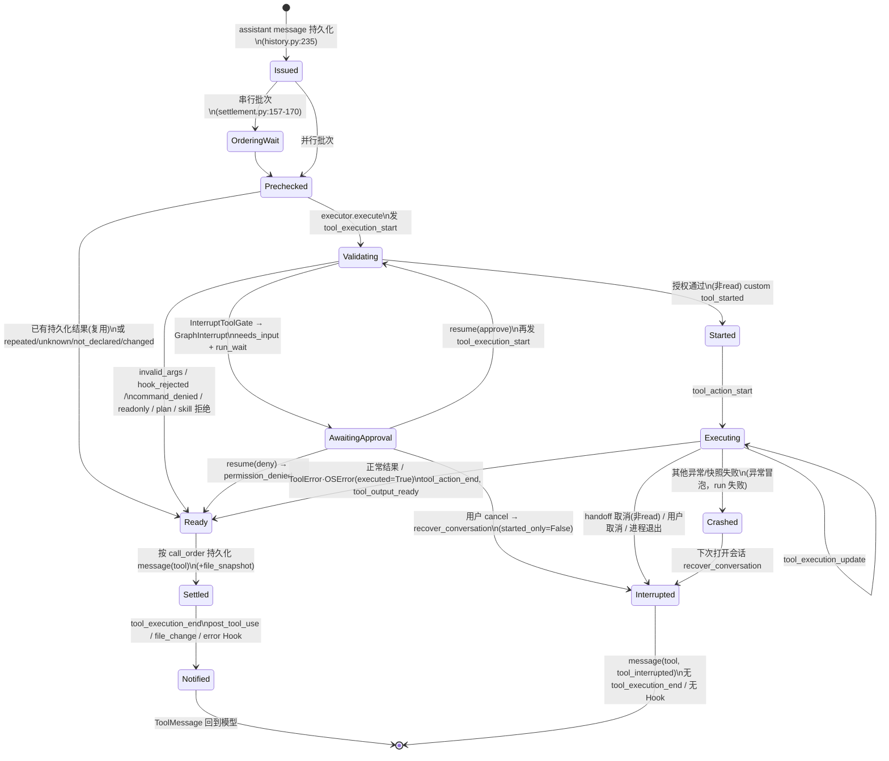

# miniclaudecode（pycode）事件定义与工具生命周期调查报告

调查对象：`/Users/cxg126/Desktop/golang/project/miniclaudecode/src/pycode`，以当前工作区（含未提交改动）为准。只读调查，未修改代码。下文路径均相对于 `src/pycode/`，行号为当前工作区行号。

辅助验证：
- `.venv/bin/python -m pytest -q tests/tools tests/hooks -p no:cacheprovider` → 170 passed
- `.venv/bin/python -m pytest -q tests/agent tests/session tests/kernel -p no:cacheprovider` → 169 passed
- 在 /tmp 用一次性脚本调用 `FileToolOutputStore.prepare` 验证了大输出会丢弃 `details`（见 §4 G1）。

---

## 0. 结论摘要

**有事件定义吗？** 有，但分成四套互不相连的分类体系，没有统一的事件类型系统：

| 体系 | 定义位置 | 类型约束 | 是否持久化 |
|---|---|---|---|
| 运行时事件流 `Event` / `EventKind`（25 种） | `kernel/domain/events.py:8-44` | `kind` 是 `Literal`；`data` 是无模式的 `dict` | 否。只在进程内（`MemoryEventJournal` 环形缓冲 2048 条） |
| Hook 事件（15 种） | `hooks/types.py:16-34` `HOOK_EVENTS` | `frozenset[str]`，加载配置时校验 | 只持久化 Hook 动作的执行记录（`hook_call`/`hook_result`/`hook_context`） |
| 会话存储记录 `SessionEntry.type`（约 30 种）+ `custom.data.kind`（约 15 种） | `kernel/domain/history.py:24-41`；部分校验在 `session/adapters/storage/session_codec.py:93-177` | `type: str`，没有枚举；codec 只校验其中一部分 | 是（session.sqlite） |
| stream-json 输出 | `ui/adapters/console.py:18-20` | 原样输出运行时 `Event` | 写到 stdout |

另外还有两层子类型：`notification` 事件的 `data.kind`（`input_delivered`/`hook`/`tool_eviction`）和 `team` 事件的 `data.type`（`agent`/`approval`/`stopped`/`wake`/`activity`/`handoff`/`message`）。三套体系之间没有映射表，映射关系藏在各处 `emit`/`append_entry`/`fire` 的调用顺序里。

**有工具生命周期吗？** 有完整的流程，但**没有显式的状态枚举或状态机对象**。一次工具调用的“状态”由以下几处隐式拼出来：
- 运行期内存集合：`RunContext.ready_results / settled_calls / dispatched_calls / interrupted_calls / tool_tasks`（`agent/services/context.py:64-74`）；
- 会话存储中的事实：assistant 消息里的 `tool_calls`、`custom{kind:"tool_started"}`、`message(role=tool)`、`custom{kind:"file_snapshot"}`、`run_wait`/`run_end`；
- `ToolResult.error_code`（如 `permission_denied`、`tool_interrupted`、`hook_rejected`）和 `details.executed`。

`tools/domain/operations.py:1` 的文档字符串写着 “explicit durable settlement states”，但文件里只有 `operation_spec_hash`，并没有状态定义。

主要风险（详见 §4）：
1. **G1** 大输出（超过 50KB 或 2000 行）进入 output store 后，`ToolResult.details` 被整体替换。ToolSearch 的 `loaded_tools` 因此丢失，搜到的工具不会被披露给模型。已用脚本复现。
2. **G2** 生命周期事件不成对：已有 `tool_execution_end`、却没有 `tool_execution_start` 的路径有多条；审批中断和重启恢复会产生重复的 start；handoff 取消、用户取消、重启恢复这三条路径都不发 `tool_execution_end`，也不触发 `post_tool_use`/`error` Hook。
3. **G3** 用户在审批等待中取消时，从未开始执行的调用也会被写成 `tool_interrupted`，文本是“previous process ended… Effects may have occurred”。这与 `docs/storage-format.md:27` 的承诺矛盾。
4. **G4** 审批“批准”的决定没有写入会话存储，只存在 LangGraph checkpoint 中；拒绝只能从结果的 `permission_denied` 间接看出。
5. **G5** 非 `ToolError`/`OSError` 的工具异常会冒泡并让整个 run 失败；`AgentSession` 只在 `DomainError` 时做恢复，此时 run 没有 `run_end`，事件流也没有 `agent_end`/`error`。

---

## 1. 事件定义

### 1.1 运行时事件流（Event / EventStream）

**定义**
- `kernel/domain/events.py:8-34` `EventKind` 共 25 种：`team, model_change, model_request_start, model_request_end, agent_start, agent_end, turn_start, turn_end, message_start, message_delta, thinking_delta, message_end, tool_execution_start, tool_action_start, tool_action_end, tool_output_ready, tool_execution_update, tool_execution_end, usage, retry, needs_input, summary, notification, error, result`。
- `kernel/domain/events.py:37-44` 信封 `Event(sequence, session_id, run_id, kind, data: dict, operation_id)`。各 kind 的 `data` 没有类型定义。
- 端口：`kernel/ports/events.py:8-38` 定义 `EventConsumer.consume`、`EventSink.emit` 和 `EventJournal.append_event/list_events/aclose`。

**发布机制**：`kernel/services/events.py:13-70` `EventStream.emit`
- 在 `asyncio.Lock` 内分配序号（有 journal 时由 journal 分配，`:35-43`），然后按顺序 `await` 每个 consumer（`:54-58`）。
- consumer 抛出 `BrokenPipeError` 时禁用该 consumer 并抛出 `OutputClosed`（`:59-61`）。抛出其他异常时只记日志并**永久禁用**该 consumer（`:62-69`）。
- `kernel/adapters/event_journal.py:11-51` `MemoryEventJournal` 是进程内环形缓冲（容量 2048），序号按 `(session_id, run_id)` 递增。文档写明重启后以会话存储为准（`:1`, `:29-33`）。

**各 kind 的发布者与字段**（根据 `grep emit(` 整理）：

| kind | 发布位置 | data 字段 |
|---|---|---|
| agent_start | `agent/adapters/history.py:89` | `{}` |
| turn_start | `history.py:90`（turn 1），`:127`（turn>1） | `turn` |
| message_start / message_end（初始输入） | `history.py:92-93` | `plain_data(Message)`，**不带 entry_id** |
| message_start（assistant 流开始） | `agent/adapters/boundaries.py:100-108` | `role, request_id, model_selection, provider_run_id` |
| message_delta | `boundaries.py:118-125` | `text, output_activity, request_id` |
| thinking_delta | `boundaries.py:130-133`, `:139-142` | `text, request_id` |
| message_start / message_end（持久化后） | `boundaries.py:174-176` `save_message` | `plain_data(Message)` + `entry_id` |
| notification(input_delivered) | `boundaries.py:182-190` | `kind, input_id, queue_kind, entry_id` |
| turn_end（无工具） | `history.py:272` | `turn, message_id` |
| turn_end（有工具，全部结算后） | `tools/adapters/settlement.py:282-289` | `turn, message_id` |
| agent_end | `history.py:323`（正常），`agent/adapters/agent.py:272`（aborted），`:277`（error） | `outcome` |
| error | `agent.py:276` | `code, message` |
| needs_input | `agent.py:288-292` | `interrupt_id, checkpoint_id, **interrupt.value`（permission/ask_user/plan） |
| tool_execution_start | `tools/services/tool_executor.py:45-49` | `call_id, name` |
| tool_execution_update | `tool_executor.py:37-42`（通过 `ToolContext.progress`） | `call_id, name, text` |
| tool_action_start | `tool_executor.py:91-99` | `name, category, timeout`（只有 Bash 有 timeout） |
| tool_action_end | `tool_executor.py:105-107`（finally） | `name` |
| tool_output_ready | `tool_executor.py:120-128`；`settlement.py:260-264`（执行前就被拒绝的结果） | `call_id, name, output_id` |
| tool_execution_end | `tool_executor.py:155-157` `completed()` | `plain_data(ToolResult)` |
| model_request_start / model_request_end / usage | `models/adapters/model_requests.py:144`, `:201-202`, `:252-253` | `RequestRecord` / `UsageRecord` |
| retry | `model_requests.py:108-119` | `request_id, attempt, max_retries, delay_seconds, error_code, source_leaf_id, source_revision` |
| model_change | `models/services/model_control.py:86-88` | `entry_id, selection` |
| summary | `context/services/summary.py:98`, `:162`, `:235`, `:305` | `job_id, status, error_code/context_tokens` |
| notification(tool_eviction) | `context/services/tool_eviction.py:81-84` | `kind, targets, reclaimed_tokens` |
| notification(hook) | `hooks/api.py:204-214` | `kind, hook_id, event, success, message, output_id` |
| team | `team/engine.py:234-236`（`emit` 包装），以及 `:409,:457,:481,:523,:525,:658,:771`；`team/mailbox.py:128-130` | `type` + 各自字段 |
| result | `session/services/session_view.py:168-182` `publish_result` | `outcome, final_text, pending, checkpoint_id, leaf_id, usage` |

**EventStream 实例的创建位置**：每个运行时容器一个（`app/composition/runtime.py:73-78`）；生命周期 Hook 各有一个，run_id 是进程 lifetime id（`app/composition/hooks.py:39-41`）；Team 一个（`app/composition/team.py:157`）；`publish_result` 时临时创建一个（`session_view.py:170`）；模型模块里也有（`models/module.py:150`）。

**订阅者**
- `ui/adapters/console.py:18-51` `ConsoleOutput`：在 `stream-json` 下每个事件输出一行 `{"type": kind, **plain_data(event)}`（`:19-20`，`kind` 字段会重复出现一次）。`json`/`text` 只处理 `team`、`tool_execution_update`、`result`。CLI 参数见 `app/cli/parser.py:17-18`。
- `ui/adapters/tui.py:241-243` 先转发到 Textual 消息泵；`:267-338` `render_runtime_event` 处理 `team, message_start(assistant), message_delta, thinking_delta, message_end, tool_execution_start/update/end, usage, error, summary, notification(hook), result`。工具卡片按 `call_id` 索引在 `_running_tools` 中（`:299-321`）。
- `team/module.py:26-27` `ChildEventRelay` → `team/engine.py:540-660` `activity`：接收 `model_request_*`、`*_delta`、`tool_action_*`、`tool_execution_update/end`、`needs_input`、`error`、`turn_*`，用来维护 phase 和 active_steps。**`tool_execution_end` 里的 `output_id`/`is_error`/`exit_code` 会写进任务 evidence**（`:628-643`），所以这个事件承担了业务语义，不只是用于显示。

### 1.2 Hook 事件

- 定义：`hooks/types.py:16-34` `HOOK_EVENTS`，共 15 种：`startup, shutdown, session_start, session_end, turn_start, turn_end, pre_send, post_receive, pre_tool_use, post_tool_use, compact, permission_request, file_change, command_execute, error`。
- 上下文：`hooks/types.py:93-126` `HookContext(session_id, run_id, workspace, boundary_id, event_name, tool_name, tool_args, file_path, message, error)`。
- 配置校验：`hooks/config.py:27-29` 拒绝未知事件；`:47-50` 只允许 `pre_tool_use` 设置 `reject`。

触发点：

| Hook 事件 | 触发位置 | boundary_id |
|---|---|---|
| startup | `app/lifecycle/session.py:72-82` | 进程 lifetime uuid |
| shutdown | `app/lifecycle/session.py:284` | 同上 |
| session_start | `agent/adapters/history.py:88`（**每次 run 都会触发**） | run_id |
| turn_start | `history.py:125` | `run:turn-N` |
| compact | `history.py:106`；`app/lifecycle/session.py:237-245`（手动） | job_id |
| pre_send | `history.py:150` | `run:model-N` |
| post_receive | `history.py:241` | assistant message.id |
| turn_end | `history.py:273`（无工具）；`settlement.py:287-289`（有工具） | assistant message.id |
| session_end | `history.py:311-313`（run 末尾且没有排队输入） | run_id |
| pre_tool_use | `tools/services/tool_executor.py:69-71`（可拒绝 → `hook_rejected`） | operation_id |
| permission_request | `tool_executor.py:72-73`（非 read 类工具；返回值被忽略） | operation_id |
| command_execute | `tool_executor.py:75-76`（category=command，授权之后） | operation_id |
| post_tool_use | `tool_executor.py:160`（持久化之后） | operation_id |
| file_change | `tool_executor.py:161-167` | operation_id |
| error | `tool_executor.py:168-169`（**只在工具结果 is_error 时触发**，模型或运行错误不触发） | operation_id |

执行语义（`hooks/api.py:84-215`）：
- 幂等键 = `hash(session, hook, boundary 或 "once")`（`:88-94`）。已有 `hook_result` 时直接复用（`:118-119`）。只有 `hook_call` 没有 `hook_result` 时，记为 `hook_interrupted`，不重跑（`:134-144`）。
- Hook 动作本身被包装成 `HookActionTool`（`:27-56`，名字 `hook__<id>`，source `hook:<user|project>`），交给**同一个 `ToolExecutor`** 的受限实例执行（`tools/module.py:209-225`，gate 是 `ConfiguredActionGate`，`hooks=None`，因此不会递归触发 Hook）。
- 副作用：Hook 动作也会在同一条事件流上发出 `tool_execution_start/action_start/action_end/output_ready/execution_end`（`hooks/api.py:155`, `:203`），`call_id` 是 `hook:<hash>`。

### 1.3 持久化记录（SessionEntry）

- 定义：`kernel/domain/history.py:24-41` `SessionEntry(id, parent_id, type: str, timestamp, data, message, selection, run_id, operation_id)`；草稿是 `EntryDraft`（`:44-52`）。
- `type` 没有枚举。`session/adapters/storage/session_codec.py:93-177` `validate_entry` 只对 `hook_call/hook_result/custom(run_start)/message/input_queued/model_change/thinking_level_change/context_edit/compaction/branch_summary/custom_message` 做结构校验，并显式拒绝旧的 `hook_review*` 类型。
- 文档列出的主要类型见 `docs/storage-format.md:19`。

代码中实际写入的 type（grep `EntryDraft(` 得到）：
`message`（`session/adapters/storage/session.py:157-166`）、`input_queued`（`session/services/durable_inputs.py:48`）、`input_expired`（`session/services/restart.py:116-122`）、`system_prompt`（`context/services/prompts.py:22`）、`tool_set_change`（`models/adapters/calibration.py:74-88`；`mcp/api.py:29`）、`mcp_catalog`（`mcp/api.py:34-36`）、`skill_catalog/skill_load/skill_install`（`skills/api.py:59`, `skills/framework.py:253`, `skills/api.py:159`）、`memory_load/memory_recall_error`（`memory/services/memory.py:96,113,147`）、`plan_state/plan_review/plan_decision`（`plans/services/plans.py:40,126,150,173`）、`hook_call/hook_result/hook_context`（`hooks/api.py:147-201`）、`compaction`（`context/services/summary.py:304`）、`context_edit`（`context/services/tool_eviction.py:50-60`）、`model_change/thinking_level_change`（`models/services/model_control.py:77,91`）、`team_agent/team_transition/team_parent`（`team/engine.py:113,385`；`session/services/agent_session.py:563`）、`fork_context`、`custom_message`、`session_metadata`、`session_deleted/session_restored`。

`custom` 记录的 `data.kind`：
`run_start`（`agent_session.py:378-389`）、`run_resume`（`:435-442`）、`run_wait`（`:462-472`）、`run_end`（`:491-504`；`restart.py:123-135`）、`tool_started`（`tools/adapters/settlement.py:553-561`）、`file_snapshot`（`agent/adapters/boundaries.py:160-172`；`hooks/api.py:171-183`）、`tool_eviction_audit`（`tool_eviction.py:66-79`）、`summary_job`（`summary.py:220`）、`compact_request`（`agent_session.py:686`）、`revert_started/revert_completed/revert_recovery`（`session/services/revert.py:111,187,257`）、`skill_created/skill_updated`（`skills/api.py:144-146`）。

### 1.4 三套体系在一次工具调用中的映射

以一次需要审批、执行成功的写类工具为例（顺序就是代码中的执行顺序）：

| 阶段 | 运行时事件 | SessionEntry | Hook |
|---|---|---|---|
| 模型返回 | `message_start`(stream) → `message_delta`* → `usage`/`model_request_end` → `message_end`(+entry_id) | `message`(assistant, tool_calls) | `pre_send`（之前）、`post_receive` |
| 进入执行器 | `tool_execution_start` | — | `pre_tool_use`, `permission_request`（Hook 动作本身还会产生 `hook_call`/`hook_result`/`hook_context` 和一组 `tool_*` 事件，以及 `notification(hook)`） |
| 审批中断 | `needs_input`（不发 `agent_end`） | `custom run_wait`（含 pending） | — |
| 恢复 | 再发一次 `tool_execution_start` | `custom run_resume` | `pre_tool_use`/`permission_request` 按幂等键复用，不重跑 |
| 授权通过 | — | **无记录** | `command_execute`（仅 command 类） |
| 实际调用 | `tool_action_start` →（`tool_execution_update`*）→ `tool_action_end` | `custom tool_started`（非 read 类） | — |
| 输出处理 | `tool_output_ready` | 输出文件或内联元数据（不是 SessionEntry） | — |
| 结算 | `message_start` + `message_end`(tool, entry_id) | `message`(tool result)、`custom file_snapshot`（有快照时） | — |
| 结算后通知 | `tool_execution_end` | — | `post_tool_use`、`file_change`、`error`（若 is_error） |
| 本批全部结算 | `turn_end` | — | `turn_end` |
| run 结束 | `agent_end` → `result` | `custom run_end` | `session_end` |

---

## 2. 工具调用生命周期（运行期）

### 2.1 参与者
- **LangGraph/Deep Agents**：负责 tool node 调度。每个 tool_call 一个协程，`ToolSettlementMiddleware.awrap_tool_call` 包裹执行（`tools/adapters/settlement.py:124-139`）。
- **ToolSettlementMiddleware**：负责排序、预检、持久化结算和中断处理（`settlement.py:103-640`）。
- **ToolExecutor**：负责校验、Hook、授权、快照、执行、输出处理（`tools/services/tool_executor.py:36-148`）和结算后通知（`:150-169`）。
- **ToolGate 链**：`tools/module.py:139-185` 按顺序组装 InterruptToolGate/ReadOnlyToolGate → MemoryToolGate → PlanToolGate → custom → _ScopedGate(Skill) → WorkerBoundaryGate/TeamToolGate。
- **AgentRuntime**：负责 run/resume/restore/invoke/collect_tools（`agent/adapters/agent.py:140-317`）。
- **AgentSession**：负责 run_start/run_wait/run_end、取消和失败恢复（`session/services/agent_session.py:127-505`），以及 `recover_conversation`（`session/services/restart.py:9-136`）。

### 2.2 隐式状态

没有 `ToolCallState` 枚举。按代码可以归纳出以下隐式状态（括号中是判断依据）：

| 隐式状态 | 判断依据 | 定义或转移位置 |
|---|---|---|
| issued | assistant `message` 已持久化且含该 call | `history.py:235` `save_message`；随后 `:236-239` 清空各集合 |
| ordering-wait | 串行模式下等待前序 call 进入 `dispatched_calls` | `settlement.py:141-171` |
| prechecked-reused | `context.completed` 中已有同 operation_id 的结果 | `settlement.py:303-312` |
| rejected-precheck | `repeated_tool_failure` / `unknown_tool` / `tool_not_declared` / `tool_declaration_changed` | `settlement.py:326-337`, `:340-378`, `:380-424` |
| rejected-validation | `incomplete_model_output` / `invalid_arguments` / schema / `hook_rejected` / `permission_denied` / `command_denied` / plan/readonly/skill/worker 拒绝 | `tool_executor.py:53-83`（统一由 `tool_failure(executed=False)` 生成） |
| awaiting-approval | `GraphInterrupt` → `interrupted_calls` 加入该 id；持久化为 `run_wait` | `settlement.py:240-248`；`tools/adapters/permissions.py:12-24,58-71`；`agent.py:286-296`；`agent_session.py:462-472` |
| started | `custom tool_started`（只记录非 read 类） | `settlement.py:549-561` |
| executing | `tool_action_start` 到 `tool_action_end` 之间 | `tool_executor.py:88-110` |
| failed-executed | `ToolError`/`OSError` 被错误边界转成 `executed=True`，非 read 类还会标 `side_effects_uncertain` | `tools/adapters/tool_errors.py:28-35`；`tools/domain/tool_failures.py:10-28` |
| ready | 在 `ready_results` 中，等待按 call_order 落盘 | `settlement.py:275-280` |
| settled | `message(tool)` 已持久化，id 进入 `settled_calls` | `settlement.py:587-632` |
| notified | `tool_execution_end` 和 post Hook 已发出，id 进入 `dispatched_calls` | `settlement.py:628-632` |
| interrupted | `error_code=tool_interrupted`（handoff 取消，或重启/取消恢复写入） | `settlement.py:219-239`；`restart.py:48-102` |
| evicted（仅影响上下文投影） | `context_edit{kind:tool_eviction}` | `context/services/tool_eviction.py:36-61` |

### 2.3 状态图（Mermaid）



### 2.4 时序图（正常路径 + 审批 + 并发）

```mermaid
sequenceDiagram
    autonumber
    participant M as Model (LangChain)
    participant H as HistoryMiddleware
    participant G as LangGraph ToolNode
    participant S as ToolSettlementMiddleware
    participant X as ToolExecutor
    participant Gate as ToolGate
    participant Hk as Hooks
    participant St as SessionStore
    participant E as EventStream
    participant AS as AgentSession

    H->>Hk: pre_send (history.py:150)
    H->>M: model request (stream)
    M-->>E: message_start / message_delta / usage / model_request_end
    H->>St: message(assistant, tool_calls) (history.py:235)
    H-->>E: message_end(entry_id)
    H->>Hk: post_receive (history.py:241)
    G->>S: awrap_tool_call × N (并发)
    S->>S: ordered_call: 串行时等前序 dispatched
    S->>S: initial_result / resolve_tool / declaration_error
    S->>X: execute(context, call, stop_reason, spec, invoke)
    X-->>E: tool_execution_start
    X->>X: stop_reason / parse_error / jsonschema
    X->>Hk: pre_tool_use (可拒绝)
    X->>Hk: permission_request (非 read)
    X->>Gate: authorize
    alt 需要审批
        Gate->>G: interrupt(permission) → GraphInterrupt
        S->>S: interrupted_calls += id; settle_ready(其他已完成的)
        G-->>AS: RunResult(needs_input)
        AS-->>E: needs_input (agent.py:292)
        AS->>St: custom run_wait
        Note over AS: 用户 approve/deny → AgentSession.resume
        AS->>St: custom run_resume
        AS->>G: Command(resume={interrupt_id: answer})
        G->>S: 重新进入 awrap_tool_call
        S->>X: execute(再次)
        X-->>E: tool_execution_start (重复)
        X->>Hk: pre_tool_use / permission_request (复用 hook_result)
        X->>Gate: authorize → @task 返回已缓存的回答
    end
    alt deny
        Gate-->>X: ToolError(permission_denied)
    else approve / 无需审批
        X->>Hk: command_execute (command 类)
        X->>X: snapshots.capture() (write/command/external)
        X->>S: invoke()
        S->>St: custom tool_started (非 read)
        S->>S: extension.before_call
        X-->>E: tool_action_start
        S->>G: handler (Deep Agents tool / MCP / native)
        X-->>E: tool_execution_update* (progress)
        X-->>E: tool_action_end
    end
    X->>X: outputs.prepare (>50KB 写文件)
    X-->>E: tool_output_ready
    X->>X: snapshot diff → details.file_snapshot
    X-->>S: ToolResult
    S->>S: ready_results[id]; 等待 call_order 前序
    S->>St: message(tool) (+ custom file_snapshot)
    S-->>E: message_start / message_end(entry_id)
    S->>S: extension.after_persist; team.settle_tool
    S->>X: completed()
    X-->>E: tool_execution_end
    X->>Hk: post_tool_use / file_change / error
    opt 本批全部 settled
        S-->>E: turn_end
        S->>Hk: turn_end
    end
    S-->>G: Command(messages=[ToolMessage])
    G->>M: 下一轮请求
```

### 2.5 各分支细节

| 分支 | 行为 | 持久化 | 事件和 Hook |
|---|---|---|---|
| 截断输出（stop_reason=length/error/aborted/content_filter） | `tools/domain/turn_guard.py:6-7` 判断不可执行，返回 `incomplete_model_output` | message(tool) | start + end，post/error Hook |
| 参数解析失败 | `tool_executor.py:58-59` 返回 `invalid_arguments`；`history.py:242-257` 把 invalid_tool_calls 规范化后交给 ToolNode | 同上 | 同上 |
| 未披露的工具 | `settlement.py:380-406` 先做只读的 validate 和 plan.guard，再返回 `tool_not_declared` | message(tool) | **没有 start**，只有 end；post/error Hook 会触发 |
| 声明变化 | `settlement.py:407-423` 返回 `tool_declaration_changed` | 同上 | 同上 |
| 连续失败（第 4 次） | `settlement.py:313-337` 以及 `tool_failures.py:31-37` | 同上 | 同上 |
| 审批拒绝 | `permissions.py:70-71` 返回 `permission_denied`（executed=False） | message(tool) | start×2（中断前一次、恢复后一次）+ end |
| 审批等待中取消 | `agent_session.py:133-150` → `cancel_wait` → `recover_conversation(outcome="cancelled", reason="user_cancel")`，`started_only` 默认 False | message(tool, `tool_interrupted`)、`input_expired`、`run_end` | **没有 end，没有 Hook** |
| 运行中取消（用户） | `agent.py:268-273` 调用 `collect_tools` 取消协程并发 `agent_end(aborted)`；`agent_session.py:390-397` 调用 `recover_conversation`，使用默认的 `reason="process_exit", outcome="interrupted"` | message(tool, `tool_interrupted`)、run_end | 没有 end，没有 Hook |
| handoff 取消 | `settlement.py:219-239` 只对非 read 类直接 `publisher.publish` 一条 `tool_interrupted`；`awrap_tool_call:131-137` 先把已就绪的结果 `settle_ready(stopping=True)` | message(tool) | 没有 end，没有 Hook，没有 `team.settle_tool`，不更新 failure_guard |
| 工具抛 ToolError/OSError | `tool_errors.py:28-35` 转成错误结果（executed=True，非 read 类标 `side_effects_uncertain`） | message(tool) | 完整 |
| 工具抛其他异常 | `ToolErrorMiddleware` 的 `aon_error` 返回 None 时会重新抛出（`.venv/.../tool_error.py:202-203`）→ `agent.py:278-282` 调用 `collect_tools` 后抛出 | 不确定：只在 `DomainError` 时恢复（`agent_session.py:398-411`），`RuntimeError` 等不会恢复 | 没有 `error`、没有 `agent_end` |
| 快照结算失败 | `tool_executor.py:145-148` 抛出 `StorageError(snapshot_settlement_failed)`，此时工具已经执行 | 有 tool_started，没有结果 → 走 DomainError 恢复，写成 `tool_interrupted` | 没有 end |
| 进程重启 | `app/composition/session.py:62-68`：如果有 pending run 且存在 checkpoint，调用 `recover_conversation(started_only=True, finish_runs=False)`，只给“已 tool_started 但没有结果”的调用补 `tool_interrupted`；否则全部补齐并写 run_end | message(tool, id=`interrupted:{msg}:{call}`) | 恢复过程不发任何事件 |
| 重启后继续 | `app/lifecycle/session.py:126-171` → `restore_task`（`agent.py:171-221`）根据持久化结果重建 `settled_calls`/`dispatched_calls` 和 failure_guard，再 `invoke(None)` 从 SQLite checkpoint 继续（`session/adapters/storage/session.py:149-155`）；已有结果的调用在 `initial_result` 中复用，不会重跑 | — | 已结算的调用不再发 end，未开始的调用会重新走一遍（read 类无条件重跑） |
| 并发多个 tool_call | `tools/domain/execution.py:6-11` 规定：任一 spec 是 sequential，整批就串行；`RunContext.execution_mode` 默认 `"parallel"`（`agent/services/context.py:44`）。并行时结果先进 `ready_results`，再严格按 `call_order` 落盘（`settlement.py:587-600`）；中断的调用会被跳过，不阻塞后面的调用 | 落盘顺序 = 声明顺序 | `tool_execution_end` 按声明顺序发出（有测试 `tests/agent/adapters/test_agent.py` `test_pi_parallel_completion_and_source_order_vectors` 覆盖） |
| 大输出 | `tools/adapters/output_store.py:142-236`：超过 50KB（`kernel/domain/truncation.py:8-9`）或 2000 行时写入 `<id>.txt`，`details` 另存为 `.artifact.json`，模型只看到预览；落盘后 `outputs.bind(output_id, entry_id)`（`boundaries.py:156-157`） | 输出对象 + message(tool) | `tool_output_ready` |
| 上下文驱逐（旧工具结果） | `context/services/tool_eviction.py:30-87`，在 `abefore_model` 中执行（`history.py:107-110`）；只追加 `context_edit`，原始结果不改 | context_edit + custom tool_eviction_audit | notification(tool_eviction) |

---

## 3. 工具定义的生命周期

1. **注册**：`tools/services/tool_registry.py:7-51`。注册是显式的，导入模块时不会自注册；名称冲突时报错（`:15-24`）；`replace_source(prefix, tools)` 按来源整体替换（`:32-39`）；`model_specs()` 过滤掉 `model_visible=False` 的工具（`:50-51`）。
2. **每次 run 组装**：`app/composition/runtime.py:49-71` 把 session tools、memory、team、skills、默认工具（ReadToolResult、主 Agent 的 AskUserQuestion）、Bash、Plan exit 合在一起。provider 不支持工具时为空；`read_only` 时只保留 read 类。
3. **框架工具**：`AgentRuntime.build` 按 `registry.model_specs()` 生成 LangChain 工具（`agent/adapters/agent.py:80-82`），另外加上 FilesystemMiddleware 的 `ls/read_file/glob/grep/(write_file/edit_file)`（`:83-98`）。之后每次模型调用时，`awrap_model_call` 会把 registry 中新增的工具补上（`history.py:153-160`），这一步是为了让 MCP 刷新后的工具也能进入请求。
4. **披露流水线**（`agent/adapters/boundaries.py:12-26` `prepare_model_boundary`）：
   - `model_filters`：Skill 范围过滤（`skills/framework.py:215-230`）；
   - `filter_model_tools`：只读模式或 Plan 规划模式下只保留 read 类工具，规划模式额外保留 write_file/edit_file（`boundaries.py:45-85`）；
   - `ToolDiscovery.disclose`（`tools/adapters/discovery.py:67-129`）：第一次调用时把自己注册为 `ToolSearch`（`:69-75`）；只预加载 `PRELOADED` 中的 8 个工具（`:22-24`），其余工具只把名称和一句话说明写进 system prompt 的目录；只有**当前 run** 中**成功持久化**的 ToolSearch 结果里的 `details.loaded_tools`（哈希必须一致）才能解锁完整定义（`:97-109`）；
   - `calibrate_model_request`（`models/adapters/calibration.py:46-109`）：把 `disclosed_tool_names` 设为本次请求实际携带的工具；工具集或 system 发生变化时写入 `tool_set_change{source:"effective_model"}`。执行前 `declaration_error` 以 `disclosed_tool_names`、`model_tools` 的 schema/implementation_hash/policy_hash 为准做校验（`settlement.py:380-424`）。`model_tools`/`disclosed_tool_names` 会写进图状态（`history.py:276-277`），供 `restore_task` 恢复（`agent.py:194-196`）。
5. **权限分层**：工具定义阶段按 category 和 source 过滤（见上一条）；执行阶段由 Gate 链负责（`tools/module.py:139-185`）。MCP 工具只有在受信任且带 `readOnlyHint` 时才算 read，否则是 external，执行方式为 sequential（`mcp/types.py:32-44`）；worker 禁止执行 mcp/hook 来源的工具（`tools/services/permissions.py:54-55`）。
6. **MCP**：
   - 打开会话时读取 `mcp.json`（项目级配置需要信任），计算配置哈希，与 pending run 的 `mcp_config_hash` 比对（`mcp/module.py:42-68`；`app/composition/session.py:94-103`）；
   - 每个 run 创建一个 `MCPRun`（`mcp/module.py:27-31`），`prepare_tools` 作为 before_model 回调（`app/composition/runtime.py:223-227`）。第一次调用时 `initialize` 列出远端工具，写入 `mcp_catalog`，哈希变化时写 `tool_set_change`（`mcp/api.py:17-38`）；之后每次模型调用都执行 `registry.replace_source("mcp:", ...)`（`:40-48`）；
   - 执行通过 `NativeToolBinding.call_scope` 和 `normalize` 完成（`mcp/framework.py:14-29`）；
   - 关闭：`MCPSession.aclose` 作为 launcher 的 resource_owner 在 `_close_all` 中关闭（`app/lifecycle/session.py:267-292`；`mcp/module.py:33-35`）。
7. **Skill**：
   - `SkillsSession.prepare_run` 扫描目录、刷新索引、生成路由和 `SkillsScopeConstraint`（`skills/module.py:56-78`）；
   - 工具有 SkillSearch（read）、InstallSkill/SaveSkill（external，source 为默认的 builtin）（`skills/tools.py:15-94`）；
   - 加载记录为 `skill_load`（`skills/framework.py:240-253`）；
   - 范围约束同时作用于披露（`filter_request`）和执行（`authorize`/`check_call`，`skills/framework.py:204-213`）。
8. **Hook 来源工具**：`HookActionTool`（`hooks/api.py:27-56`）只注册在 Hook 专用 registry 中（`tools/module.py:209-225`），对模型不可见；配置在打开会话时加载（`hooks/module.py:45-54`），哈希写进 run_start，用于恢复校验；生命周期 Hook 引擎在 launcher 关闭时触发 `shutdown`。

---

## 4. 缺口与风险

### G1（高，已复现）大输出替换 `details`，ToolSearch 解锁失败
- 位置：`tools/adapters/output_store.py:198-207`（已发布路径）和 `:542-552`（写文件路径）。大输出时 `details` 被替换为 `{"output": {...}}`，原 details 只存在 `.artifact.json` 中。
- 调用顺序：`tool_executor.py:115-117` 先 `prepare`，`:129-143` 再加 `file_snapshot`，所以快照信息不受影响。但 `ToolSearch` 的 `details.loaded_tools`（`discovery.py:64`）、`tool_failure` 的 `executed`/`side_effects_uncertain` 都会丢失。
- 后果：`discovery.py:100-103` 只读取持久化结果的 `details.loaded_tools`。`limit` 最大为 20，返回的是完整 schema，MCP 工具很容易超过 50KB。超过后，模型被告知“下一次请求可调用”，实际却拿不到这些工具，后续调用会得到 `tool_not_declared`。同时模型看到的 JSON 也被截断。
- 复现：对 60KB 文本调用 `prepare`，`details` 由 `{'loaded_tools': …}` 变成 `{'output': {...}}`。小输出保留原 details。
- 建议：结果中的控制字段（`loaded_tools`、`executed`、`side_effects_uncertain`）不要放进可驱逐的 details，可以放进白名单保留，或放到 ToolResult 的独立字段；ToolSearch 返回精简定义，或对总字节设上限。

### G2（中）工具事件不成对，终态事件缺失
- 已有 end 但没有 start：`initial_result` 和 `declaration_error` 产生的拒绝不经过 `executor.execute`，却在 `settle_ready` 中调用 `completed()`（`settlement.py:196-205`, `:628`）。
- 重复 start：审批恢复、重启继续都会重新进入 `executor.execute`（`tool_executor.py:45`）。TUI 靠 `identifier not in self._running_tools` 去重（`ui/adapters/tui.py:301`），stream-json 消费者会看到两次。
- 没有 end：GraphInterrupt（`settlement.py:240-248`）、handoff 取消（`:219-239`）、用户取消和重启恢复（`session/services/restart.py:96-102`，只 `append_message`，不发事件）。TUI 的“运行中”卡片只有在 `render_history` 清空 transcript 时才会消失，而 `_running_tools` 字典仍保留旧条目（`tui.py:318-321`, `:418-421`）。
- 对 Hook 和 Team 的影响：这些路径不触发 `post_tool_use`/`error` Hook；Team 的 evidence 依赖 `tool_execution_end`（`team/engine.py:628-643`），也会漏记。
- 建议：定义明确的终态事件（例如 `tool_execution_end` 增加 `status: completed|denied|interrupted|cancelled`）；在 `recover_conversation` 和 handoff 分支中经由同一个结算出口（发事件 + 触发 Hook）；`tool_execution_start` 增加 `attempt` 字段，或改为只在首次发出。

### G3（中）取消时把未执行的调用写成“可能已产生副作用”
- `agent_session.py:139-147`（等待中取消）和 `:392-397`（运行中取消）调用 `recover_conversation` 时都没有传 `started_only=True`，`restart.py:57-59` 因而不会区分是否 `tool_started`。所有未配对的调用统一写成 `"tool_interrupted: the previous process ended … Effects may have occurred"`（`restart.py:75-87`）。
- 运行中取消使用默认的 `reason="process_exit"`（`restart.py:13`），审计记录与实际原因不符。
- 与文档矛盾：`docs/storage-format.md:27` 写的是“没有开始的审批不会被误标记成已经执行”。
- 建议：根据有无 `tool_started` 使用不同的 error_code（如 `tool_cancelled` 表示未执行，`tool_interrupted` 表示已开始），用户取消时传入 `reason="user_cancel"`。

### G4（中）审批决定没有写入会话存储
- 批准（approve）只保存在 LangGraph checkpoint 中 `@task pycode_permission` 的结果里（`tools/adapters/permissions.py:12-24`）；`run_resume` 只记录 `input_id`（`agent_session.py:435-442`）。`grep decision` 在 session/agent 中找不到持久化写入。Plan 的决定有 `plan_decision` 记录（`plans/services/plans.py:150,173`），工具审批没有对应记录。
- 后果：无法从 session.sqlite 审计“谁在何时批准了哪个 operation”；fork 或删除 checkpoint 后无从追溯。
- 建议：resume 时追加 `custom{kind:"tool_approval", operation_id, decision, spec_hash}`。

### G5（中）非领域异常导致 run 悬空
- `tool_errors.py:30-31` 只转换 `ToolError`/`OSError`。其他异常（包括 `TypeError("Tool execution must return a ToolResult")`，`:39-40`）会穿透 `agent.py:278-282`，不发 `error`/`agent_end`；`agent_session.py:398-411` 只处理 `DomainError`，所以不会写 `run_end`。下次打开会话时，如果 checkpoint 存在，会走 `started_only` 路径，这次 run 还可以继续执行。
- 建议：在 `AgentRuntime.invoke` 的 BaseException 分支发出 `error`/`agent_end(outcome=error)`；`AgentSession.run` 对 `Exception` 也执行恢复。

### G6（低）事件体系分散，缺少类型约束
- `Event.data` 是 `dict[str, Any]`（`kernel/domain/events.py:43`），25 种 kind 都没有 payload schema。例如初始输入的 `message_end` 不带 `entry_id`（`history.py:93`），持久化路径的 `message_end` 带 `entry_id`（`boundaries.py:176`）。
- `SessionEntry.type` 是自由字符串，codec 只校验一部分；`custom.kind` 又是第二层自由字符串。Hook 事件与运行时事件名字有重叠（`turn_start`/`turn_end`/`error`），但语义不同：Hook 的 `error` 只覆盖工具错误，`session_start`/`session_end` 实际是按 run 触发（`history.py:88`, `:311`）。
- TUI 检查 `notification(hook)` 的 `error_code` 字段（`tui.py:333`），但该事件根本不带这个字段（`hooks/api.py:206-213`）。
- stream-json 同时输出 `type` 和 `kind`（`console.py:20`）。
- 建议：为每个 EventKind 定义 TypedDict 或 dataclass payload；把 SessionEntry type 和 custom kind 整理成枚举，并写一份“事件 ↔ 记录 ↔ Hook”映射文档。

### G7（低）EventStream 的投递语义
- 所有 consumer 在锁内串行 `await`（`kernel/services/events.py:34-58`）。Team 的 `activity` 会写盘（`team/engine.py:654-657`），慢 consumer 会阻塞 token 流和所有工具事件。
- consumer 只要抛一次异常就被永久禁用（`:62-69`），Team 的 evidence 可能因此静默丢失。
- 序号不持久（`event_journal.py:22-23`），重启后同一 run_id 的序号从 1 重新开始，外部消费者不能用 `(run_id, sequence)` 去重。

### G8（低）死代码和命名不一致
- `InterruptToolGate`（`tools/adapters/permissions.py:45`）和 `WorkerBoundaryGate`（`tools/services/permissions.py:59`）检查 `source.startswith("skill:")`，但 `src` 中没有任何 ToolSpec 使用这个 source，Skill 脚本实际走 Bash（builtin）。
- `recover_tool` 参数在 `restart.py:68` 被使用，但 app 层从未传入（grep 无结果），所以永远是 None。
- `tools/domain/operations.py:1` 的文档字符串说有“explicit durable settlement states”，实际没有。
- 正常结果的 message id 是 `result:{operation_id}`（`settlement.py:298`, `:603`），恢复结果是 `interrupted:{msg}:{call}`（`restart.py:97`），两种格式不一致。
- `permission_request` Hook 在自动批准（memory、sandbox auto、plan auto）时也会触发（`tool_executor.py:72-73`，在 `authorize` 之前），名字与语义不符。

### G9（低）handoff 取消分支的副作用不完整
`settlement.py:219-239` 中直接 `publish` 的中断结果没有经过 `settle_ready`，导致：不调用 `failure_update`，不加入 `settled_calls`，不调用 `extension.after_persist`（Skill 加载记录），不调用 `team.settle_tool`。后续 `restore_task` 能从 completed 重建 settled 状态（`agent.py:213-219`），因此不会重复执行，但扩展和 Team 的副作用会漏掉。read 类工具被取消时不写任何结果，要等后续恢复才补。

---

## 5. 结论与建议

- **事件**：项目有一套明确的运行时事件信封（`Event` + 25 种 `EventKind`），由单一的有序发布器 `EventStream` 发出，TUI、Console/stream-json、Team 三类消费者订阅。另有 15 种 Hook 事件和开放式的 SessionEntry 类型。三者独立定义，靠调用顺序隐式对齐，没有统一的类型体系和映射表。
- **工具生命周期**：流程完整而且考虑周到，包括按声明顺序结算、先持久化再通知、`tool_started` 区分是否开始执行、checkpoint 恢复不重复执行、重复失败熔断、声明哈希校验、大输出外置。但状态是隐式的，分散在内存集合、存储记录和 error_code 中，没有可查询的 `ToolCallState`。
- **优先修复顺序建议**：
  1. G1：保护 `loaded_tools`/`executed` 等控制字段，避免被大输出处理替换；
  2. G2 + G3：统一终态出口，用 `status` 区分 completed/denied/cancelled/interrupted，恢复路径也发事件、触发 Hook，用户取消时尊重 `tool_started`；
  3. G4：持久化审批决定；
  4. G5：非领域异常也要收尾 run；
  5. 可选：引入显式的 `ToolCallState` 枚举，并在 `tool_execution_*` 事件中携带该字段；为 EventKind 定义 payload 类型；补一份“事件 ↔ SessionEntry ↔ Hook”映射文档（可以放在 `docs/architecture.md`）。
