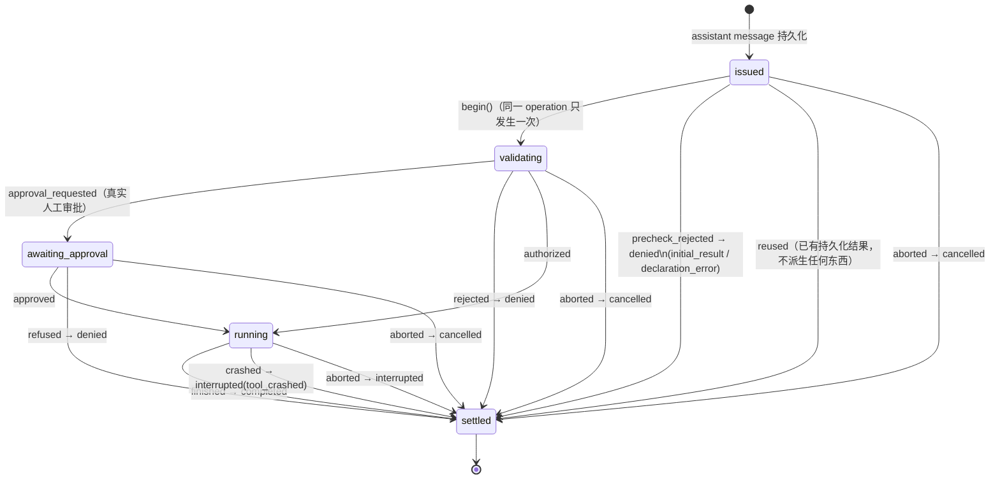
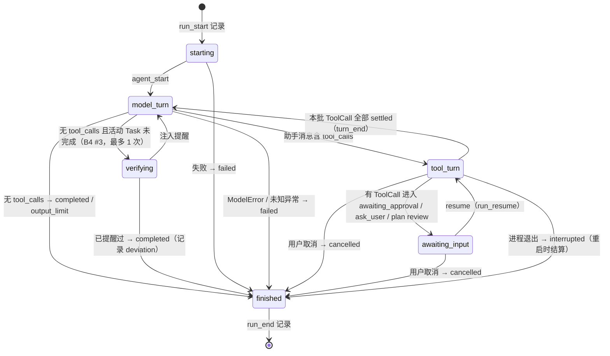
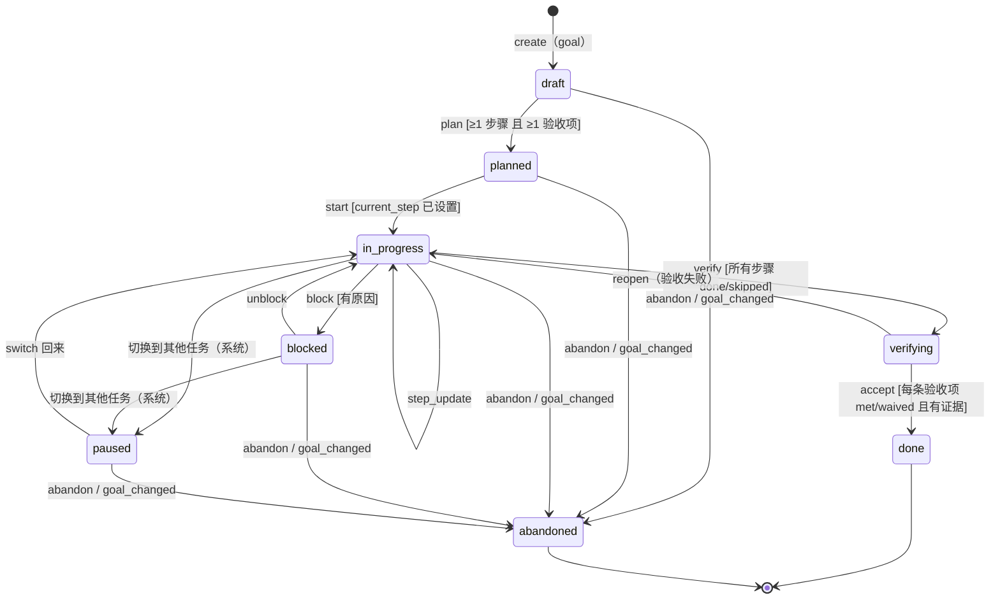
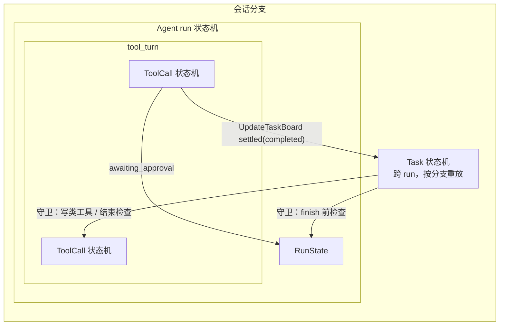

# miniclaudecode（pycode）方案设计：事件与工具生命周期简化（A）＋防跑偏任务状态机（B）

日期：2026-11-01。只读调查，没有修改源码，没有提交，没有读取 `.env`。以当前工作区（含未提交改动）为准。下文路径相对于 `src/pycode/`，另有说明的除外。

前置材料：`.agents/tasks/miniclaudecode-project-analysis-2026-11-01.md`（下称“项目分析”）、`.agents/tasks/miniclaudecode-events-tool-lifecycle-2026-11-01.md`（下称“事件调查”，G1-G9 编号沿用）。

辅助验证：`.venv/bin/python -m pytest -q tests/context tests/agent tests/memory/services/test_task_recall.py -p no:cacheprovider` → **114 passed**（12.9 s）。

---

## 0. 摘要

**方案 A（事件与工具生命周期）**
1. 先单独修 **G1**，作为第一个提交。理由：方案 B 推荐的任务工具会把任务变更放进工具结果的 `details`，G1 不修，大输出会把它连同 `loaded_tools` 一起丢掉。修法是给 `ToolResult.details` 定义一组“控制字段”白名单，`output_store.prepare` 外置大输出时保留这些字段（`tools/adapters/output_store.py:198-207`、`:542-552`）。
2. 新增 `ToolCallState` 状态机（`tools/domain/tool_call_state.py`，纯转移表），配一个唯一的结算出口 `ToolCallLifecycle.settle()`（`tools/services/tool_lifecycle.py`）。正常结算、预检拒绝、handoff 取消、用户取消、重启恢复全部走这个出口。运行时事件、Hook、SessionEntry 都按“转移 → 派生”表生成，不再在各处手写 `emit`/`fire`/`append_entry`。
   - G2：每个 operation 恰好一个 start 和一个 end。
   - G3：按是否有 `tool_started` 把终态区分为 `cancelled` 或 `interrupted`。
   - G5：只解决工具层（未知异常结算为 `interrupted/tool_crashed`），run 层要由 Agent 状态机补上。
   - G4：`awaiting_approval → running/denied` 是显式转移，派生一条 `custom{kind:"tool_approval"}`，所以 G4 顺带解决，但要按 operation_id 去重。
3. 工具运行时事件从 6 种收敛到 3 种：`tool_execution_start / update / end`。`tool_action_start/end` 改为 `update` 里的 `state` 字段，`tool_output_ready` 改为 `end` 里的 `output_id`。`end` 新增 `status ∈ {completed, denied, cancelled, interrupted}`。
4. `message_start` 只给流式的助手消息发。`message_end` 统一定义为“一条 message SessionEntry 已写入”，并且总是带 `entry_id`。
5. Hook 调整：
   - `permission_request` 改为只在真正需要人工审批时触发；
   - `command_execute` 降为别名（等价于 `running` 转移且 category=command）；
   - `session_start/session_end` 改名为 `run_start/run_end`，旧名作为别名保留。
   - 别名在**匹配阶段**解析，不改写 `Hook.event`，所以 `hook_config_hash` 和 Hook 幂等键不变（`hooks/module.py:57-59`、`hooks/api.py:87-93`）。
6. 事件 `data` 改为每个 kind 一个 TypedDict。`SessionEntry.type` 改为 `StrEnum` 并完整校验。旧会话可以继续读：新增记录都是增量的，旧记录的 `status` 从 `error_code` 推导。

**方案 B（防跑偏）**
1. 工作区里未提交的功能已经实现了单 Agent 任务的数据模型、分支内重放、证据校验、每轮注入和记忆联动。它缺少：显式的任务状态机（status 只是字段枚举，转移靠散落的 `if`）、验收项状态、偏离检测、运行结束前检查、用户可见性（TUI 和 stream-json 都不显示）、用户编辑。它最大的风险是 JSON 契约（`agent/adapters/task_output.py:48-69`）：一次违约就让整个 run 失败，响应也不保存。
2. **推荐把更新机制从强制 JSON 改为专用工具 `UpdateTaskBoard`**，模型正常输出文字。比较见 §B3。核心理由：
   - 违约只会得到一条工具错误，模型可以自行重试，run 不会失败；
   - 原生 tool calling 是各 provider 共同支持的能力；
   - 不再每轮在历史里重放 JSON 信封；
   - 任务变更直接成为一次 ToolCall，进入方案 A 的状态机和映射表。
3. 用户补充要求做三层状态机：Agent（run）/ Task / ToolCall。三者用同一个纯转移表机制定义（`kernel/domain/state_machine.py`，自研，不引入库），每次转移产出“效果”数据（事件 / Hook / 记录），由各功能的 services 层解释执行。嵌套关系是 Agent ⊃ ToolCall，Task 与 run 正交（一个 Task 可以跨多次 run）。三者之间有 4 条互相约束的守卫（§B6.4）。
4. team/tasks.py 的团队任务板**不和单 Agent 任务统一**。两者语义不同：Team 是多主体的所有权/验收协议，按全会话重放；单 Agent 任务按当前分支重放。可以共享的是状态机机制，不共享数据模型。
5. 推荐整体顺序：A0（G1）→ A1（状态机机制、类型、枚举）→ A2（ToolCall 状态机和结算出口）→ A3（事件收敛和 Hook 别名）→ B1（Agent run 状态机，补 G5 的 run 层）→ B2（Task 状态机和 UpdateTaskBoard，替换 JSON 契约）→ B3（防跑偏检查）→ B4（TUI /tasks 与 stream-json）。待你拍板的问题见 §C。

---

# 方案 A：事件与工具生命周期简化

## A1. 现状要点（只列方案依赖的证据）

| 事实 | 位置 |
|---|---|
| 工具事件 6 种：start / action_start / action_end / output_ready / update / end | `kernel/domain/events.py:21-26`；`tools/services/tool_executor.py:45-49, 91-107, 120-128, 155-157`；`tools/adapters/settlement.py:260-264` |
| 结算出口分散：正常结算在 `settle_ready`（`settlement.py:587-631`）；handoff 取消直接 `publisher.publish`（`:219-239`）；中断只加入 `interrupted_calls`（`:240-248`）；重启和取消在 `session/services/restart.py:96-102` 只 `append_message` | 同左 |
| 用户取消（等待中）传了 `reason="user_cancel"`，但没传 `started_only`（`session/services/agent_session.py:139-147`）；运行中取消使用默认的 `process_exit`（`:390-394`） | 同左 |
| 恢复结果的文本一律是“Effects may have occurred”（`restart.py:75-87`） | 同左 |
| `recover_tool` 注入口已经存在，但 app 层从未传入（`restart.py:68`；`agent_session.py:146, 393`） | 可复用为结算出口的注入点 |
| `permission_request` 在 `authorize` 之前触发，返回值被丢弃（`tool_executor.py:72-73`）；`command_execute` 在授权后触发（`:75-76`） | 同左 |
| `session_start` 每次 run 都触发（`agent/adapters/history.py:88`），`session_end` 在 run 末尾触发（`:311-313`） | 同左 |
| Hook 幂等键包含 `plain_data(hook)`（`hooks/api.py:87-93`），配置哈希也基于解析后的 Hook 对象（`hooks/module.py:57-59`），pending run 恢复时会比较这个哈希（`hooks/config.py:115-119`） | 改 Hook 名时必须考虑 |
| 助手消息：`message_start` 由流式回调在**每次请求尝试**时发出（`agent/adapters/boundaries.py:94-108`），`message_end` 由 `save_message` 发出（`:174-176`）；工具结果用 `emit_start=True`，start 和 end 紧挨着发（`settlement.py:602-605`），随后还有 `tool_execution_end`；初始输入在 `abefore_agent` 补发 start/end，且不带 entry_id（`history.py:91-93`），实际写入在 `agent/adapters/agent.py:143-145`，那里不发事件 | 同左 |
| Team 依赖：`tool_action_start` 的 `timeout/name` 用于设截止时间和记录 Bash 源版本，`tool_action_end` 用于移除活动步骤，`tool_execution_end` 的 `output_id/is_error/exit_code/name` 写进任务 evidence（`team/engine.py:543-660`） | 迁移必须保持 |
| TUI 只认 `tool_execution_start/update/end` 三种工具事件（`ui/adapters/tui.py:298-321`） | 收敛后 TUI 基本不用改 |
| stream-json 原样输出全部事件，并重复输出 `kind`（`ui/adapters/console.py:18-20`）；evals 只消费轨迹事件（`evals/scripts/run_trajectory_quality.py:57-59`）和 SessionEntry（`evals/coding/solver.py:78`） | 外部兼容面 |
| `validate_entry` 在**读取**时执行（`session/adapters/storage/session_codec.py:87, 99-178`），当前只校验部分 type | 引入枚举后要考虑旧数据 |

## A2. G1 先单独修复（第一个提交）

- **问题**：`output_store.prepare` 外置大输出时，把 `details` 整体替换成 `{"output": {...}}`（`output_store.py:198-207` 是已发布路径，`:542-552` 是写文件路径）。`ToolSearch` 的 `details.loaded_tools`（`tools/adapters/discovery.py:64`）因此丢失，`disclose` 只从持久化的结果中读取这个字段（`:100-103`），结果是工具解锁失败。`executed`、`side_effects_uncertain` 也一起丢失。
- **修法**：
  1. 在 `tools/domain/` 定义 `CONTROL_DETAIL_KEYS = frozenset({"loaded_tools", "executed", "side_effects_uncertain", "source_assistant_id", "file_snapshot", "read_receipts", "task_change"})`（`task_change` 为方案 B 预留）。
  2. `prepare` 的两条大输出分支改为 `{**{k: v for k in CONTROL_DETAIL_KEYS if k in result.details}, "output": {...}}`。其余 details 仍放在 `.artifact.json`。
  3. 另外给 `ToolSearch` 的返回总字节设上限：超过时只返回名称和 schema 摘要，避免模型看到截断的 JSON。
- **为什么先做而且单独做**：改动约 20 行，不依赖状态机；风险已经复现；方案 B 的 `UpdateTaskBoard` 结果也依赖这个保证。
- **测试**：在 `tests/tools/adapters/test_tool_outputs.py` 增加一个 60KB 结果、details 带 `loaded_tools` 的用例；在 `tests/tools/adapters/test_tool_discovery.py` 增加“大结果仍能解锁”的用例。

## A3. ToolCall 状态机定义

### A3.1 状态与终态

`ToolCallState(StrEnum)`：`issued, validating, awaiting_approval, running, settled`。
`ToolCallStatus(StrEnum)`（只在 settled 时有值）：`completed, denied, cancelled, interrupted`。

| 终态 status | 含义 | 对应现有 error_code |
|---|---|---|
| completed | 工具执行过并返回了结果，结果可能是 `is_error`（如 ToolError、exit≠0） | 正常、`tool_execution_error` 等 |
| denied | 执行前就被拒绝，**确定没有副作用** | `permission_denied`、`hook_rejected`、`invalid_arguments`、`incomplete_model_output`、`tool_not_declared`、`tool_declaration_changed`、`unknown_tool`、`repeated_tool_failure`、plan/readonly/skill/worker 拒绝（共同点是 `details.executed=False`） |
| cancelled | 在进入 running 之前被取消（用户取消、handoff、进程退出），**没有执行** | 新增 `tool_cancelled` |
| interrupted | 进入 running 之后被打断，副作用不确定 | `tool_interrupted`；新增 `tool_crashed`（非 ToolError 异常） |

判断 cancelled 还是 interrupted 的唯一依据，是有没有持久化的 `custom{kind:"tool_started"}`（`settlement.py:549-561`）。read 类工具不写 `tool_started`，因为 read 类没有副作用，所以 read 被打断时一律记为 cancelled。

### A3.2 状态图



`aborted` 统一代表用户取消、handoff 取消、进程退出或 run 失败后的恢复，原因放在 `reason` 字段（`user_cancel | handoff | process_exit | run_error`）。

### A3.3 实现位置与出口

- **`kernel/domain/state_machine.py`**（新，纯 Python）：通用的 `Transition(source, trigger, target, guard=None)` 和 `Machine(transitions).apply(state, trigger, **facts) -> (target, effects)`。非法转移抛 `DomainError("invalid_transition")`。效果是数据：`EmitEvent(kind, payload)`、`FireHook(name, ...)`、`AppendEntry(draft)`。方案 B 的三层状态机共用这一套。
- **`tools/domain/tool_call_state.py`**（新）：枚举、转移表，以及“转移 → 效果”派生函数（A4 表格的代码化）。
- **`tools/services/tool_lifecycle.py`**（新）：`ToolCallLifecycle`，按 operation_id 保存内存状态，依赖已有端口 `EventSink`、`ToolHooks`（`tools/ports/hooks.py`）和 publisher。主要方法：
  - `begin`、`request_approval`、`authorize`、`decide`、`start_running`：由 `ToolExecutor.execute` 在原位置调用，替换现在的手写 emit/fire；
  - **`settle(call, result, status, reason)`：唯一出口**。依次执行：持久化 message(tool)（以及 file_snapshot）→ `failure_update` → `extension.after_persist` → `team.settle_tool` → 派生 end 事件和 post Hook。也就是把 `settle_ready` 里 `:595-631` 的逻辑整体搬进来；
  - `settle_orphans(snapshot, reason)`：供 `restart.py` 使用，替代 `:48-102` 的循环，通过已有的 `recover_tool` 注入口由 app 层传入。session 依赖 tools 在 DAG 里是允许的（`scripts/check_architecture.py:24`）。
- **调用点改造**：
  - `settlement.py:219-239`（handoff）：改为 `settle(status=cancelled 或 interrupted)`，同时补上 G9 漏掉的 `after_persist`、`team.settle_tool` 和 failure_guard 更新。
  - `settlement.py:303-424`（预检）：返回结果后走 `issued → settled(denied)`。
  - `agent_session.py:139-147, 390-397`：传入正确的 `reason`。由出口根据 `tool_started` 决定 status，所以不再需要 `started_only` 这类参数。

### A3.4 状态持久化与恢复

只持久化有恢复意义的转移，其余只存在内存中：

| 状态 | 持久化事实 | 重启后如何还原 |
|---|---|---|
| issued | assistant `message.tool_calls` | path 中有 call 但没有结果 |
| awaiting_approval | `run_wait.pending` 中带 operation_id | `restore_task`（`agent/adapters/agent.py:171-221`）读取 run_wait |
| running（仅非 read 类） | `custom tool_started` | 同上 |
| 审批决定 | **新增** `custom{kind:"tool_approval", operation_id, decision, spec_hash}` | 同上（G4） |
| settled | `message(tool)`，`details.status`（新增字段；旧记录按 error_code 推导） | `settled_calls` 重建逻辑不变（`agent.py:213-219`） |

## A4. 转移 → 派生映射表

| 转移 | 运行时事件 | Hook | SessionEntry |
|---|---|---|---|
| issued → validating（begin） | `tool_execution_start{call_id,name,operation_id}` | `pre_tool_use`（可拒绝） | — |
| validating → awaiting_approval | `tool_execution_update{state:"awaiting_approval"}`；run 层另发 `needs_input` | `permission_request`（**新语义：只在真实审批时触发**） | run 层写 `run_wait` |
| awaiting_approval → running（approved） | `tool_execution_update{state:"running", category, timeout}` | `command_execute` 别名（仅 category=command） | `tool_approval{decision:"approve"}`；非 read 类写 `tool_started` |
| validating → running（自动授权） | 同上 | 同上 | 非 read 类写 `tool_started` |
| running 期间的进度 | `tool_execution_update{state:"running", text}` | — | — |
| awaiting_approval → settled(denied) | `tool_execution_end{status:"denied", ...result}` | `post_tool_use`、`error` | `tool_approval{decision:"deny"}`、`message(tool)` |
| validating / issued → settled(denied) | `tool_execution_end{status:"denied"}`（预检拒绝时前面先补一条 start，保证成对） | `post_tool_use`、`error` | `message(tool)` |
| running → settled(completed) | `message_end{entry_id}` → `tool_execution_end{status:"completed", output_id, ...}` | `post_tool_use`、`file_change`（有改动时）、`error`（is_error 时） | `message(tool)`，可能还有 `file_snapshot` |
| * → settled(cancelled / interrupted) | `tool_execution_end{status, reason}`（重启恢复时只有存在事件订阅者才发） | `post_tool_use`、`error`（HookContext 新增 `status`，见 §C） | `message(tool, tool_cancelled / tool_interrupted)` |
| 本批全部 settled | `turn_end` | `turn_end` | — |

固定顺序：先持久化，再发事件，最后触发 Hook。这与现在 `completed()` 的约定一致（`tool_executor.py:151`）。

## A5. G2 / G3 / G4 / G5 如何解决

| 问题 | 如何解决 | 程度 |
|---|---|---|
| G2 事件不成对 | `begin` 每个 operation 只允许一次（转移表中 `validating` 不能再回到 `validating`），审批恢复走的是 `awaiting_approval → running`，所以只发 update 不发 start；所有终态都经过 `settle`，`settle` 一定发 end；预检拒绝在 end 之前补 start | 完全解决 |
| G3 取消误标 | 出口根据 `tool_started` 选择 cancelled 或 interrupted，文本和 error_code 都不同；`reason` 记录真实原因 | 完全解决；同时修正 `docs/storage-format.md:27` 承诺与实现不一致的问题 |
| G4 审批未持久化 | 审批是显式转移，派生 `tool_approval` 记录。注意：恢复时 `@task pycode_permission`（`tools/adapters/permissions.py:12-24`）会返回缓存答案，转移会再走一次，所以写入前要按 operation_id 检查是否已有记录 | 顺带解决（需要幂等） |
| G5 非领域异常 | 工具层：`tools/adapters/tool_errors.py:28-35` 的错误边界对其他 `Exception` 也调用 `settle(status=interrupted, error_code="tool_crashed")`，并记录 traceback 日志。`snapshot_settlement_failed` 仍是 run 级的 StorageError。run 层：`agent.py:280-283` 不发 `error/agent_end`，`agent_session.py:398-411` 只处理 DomainError，这部分由方案 B 的 Agent 状态机统一收尾 | 工具层解决，run 层要在 B1 补 |

## A6. 事件精简清单

### A6.1 运行时事件（25 → 21 种，其中新增 1 种 `task`，见方案 B）

| 现有 | 处理 | 替代 |
|---|---|---|
| tool_execution_start | 保留，语义改为“每个 operation 一次” | — |
| tool_execution_update | 保留，新增 `state` 字段；`text` 变为可选 | — |
| tool_execution_end | 保留，新增 `status`、`reason`、`state:"settled"` 字段；仍包含 `plain_data(ToolResult)` 的全部字段 | — |
| tool_action_start | **删除** | `update{state:"running", category, timeout}` |
| tool_action_end | **删除** | 由 `end` 表示（Team 在 end 时移除活动步骤） |
| tool_output_ready | **删除** | `end.output_id` |
| message_start | 保留，但**只用于流式助手消息**，必须带 `request_id`；重试时会对同一 message 多次出现，消费方按 request_id 处理 | — |
| message_end | 保留，语义改为“一条 message SessionEntry 已写入”，**总是带 entry_id**；助手消息额外带 `request_id` | 初始输入改在 `AgentRuntime.run`（`agent.py:143-145`）写入后发出，删除 `history.py:91-93` 的补发 |
| 其他 | 不变 | — |

工具结果不再发 `message_start`（`settlement.py:603` 的 `emit_start=True` 改为 False）。`deliver_input`（`boundaries.py:183`）同样处理。

### A6.2 Hook 事件（15 种，名字保留为别名，对外概念减为 13 种）

| Hook | 处理 |
|---|---|
| permission_request | 保留名字，改语义：只在 `validating → awaiting_approval` 时触发，自动批准（memory、sandbox on-auto、plan auto）时不再触发；明确为“只通知”，配置 `reject` 本来就禁止（`hooks/config.py:47-50`） |
| command_execute | 降为别名：等价于“进入 running 且 category=command”。文档标为 deprecated，配置继续可用 |
| session_start / session_end | 改名为 `run_start / run_end`，旧名作为别名。不新增真正的“会话级”Hook，进程级已有 `startup/shutdown` |
| error | 保留，文档明确只覆盖工具结果错误；B1 之后可以考虑增加 `run_error`（见 §C） |
| 其余 | 不变 |

**别名实现**：`HOOK_ALIASES = {"session_start": "run_start", "session_end": "run_end", "command_execute": ("run_tool", {"category": "command"})}`。`parse_hooks` 接受旧名，`Hook.event` 保持用户写的原值；`HookEngine.fire` 匹配时用 `canonical(hook.event) == context.event_name`（`hooks/api.py:85-87`）。这样 `hook_config_hash` 和幂等键都不变，升级前已经 pending 的 run 不会因为“配置变化”被拒绝恢复。加载到旧名时可以发一条 `notification(kind:"hook", success:true, message:"deprecated")` 提示用户。

### A6.3 类型化与枚举

- `kernel/domain/event_payloads.py`：每个 EventKind 一个 TypedDict（例如 `ToolExecutionEnd(TypedDict): call_id, name, status, ...`）。`EventStream.emit` 的签名用 `@overload` 把 kind 和 payload 类型绑定，由 pyright（项目已经启用，0 error）静态检查。运行时不做 schema 校验，避免影响 token 流的性能。
- `kernel/domain/history.py`：新增 `EntryType(StrEnum)`，覆盖事件调查 §1.3 列出的全部 type（`message, input_queued, input_expired, system_prompt, tool_set_change, mcp_catalog, skill_catalog, skill_load, skill_install, memory_load, memory_recall_error, plan_state, plan_review, plan_decision, hook_call, hook_result, hook_context, compaction, context_edit, model_change, thinking_level_change, team_agent, team_transition, team_parent, fork_context, custom_message, session_metadata, session_deleted, session_restored, branch_summary, custom`，以及新增的 `task_change`），再加 `CustomKind(StrEnum)`。`EntryDraft.__post_init__` 在写入时校验；`validate_entry` 在读取时也校验（`session_codec.py:99`）。
- 用一个测试用 AST 扫描 `EntryDraft("...")` 的字面量，确保所有写入点都在枚举里，防止以后漂移。
- 顺手修两处：stream-json 去掉重复的 `kind`（`console.py:20`），TUI 不再检查不存在的 `error_code` 字段（`tui.py:333`）。

## A7. 兼容性影响

| 消费方 | 影响 | 处理 |
|---|---|---|
| 用户 Hook 配置（`hooks/config.py`） | 旧名仍然有效 | 别名在匹配阶段解析（A6.2）；`permission_request` 在自动批准时不再触发，属于行为变化，写进 CHANGELOG/README |
| stream-json 消费者 | 3 种事件消失，`end` 增加字段 | A3 步骤中**同时发新字段和旧事件**（过渡期），A3b 再删除旧事件；每行增加 `"schema": 2`。项目没有已知的外部消费者（README 声明不配 CI），过渡期可以只保留一个提交 |
| TUI（`ui/adapters/tui.py:298-321`） | 只用 start/update/end | `update` 的 `text` 变为可选，要改成 `event.data.get("text")` 并判空；end 后 `_running_tools` 不再残留，取消后的“运行中”卡片能正确消失 |
| Team（`team/engine.py:543-660`） | 依赖 action_start/end 和 end | `accepted` 集合改为认 `tool_execution_update{state:"running"}`（取 timeout、name，记录 Bash 源版本）；在 `tool_execution_end` 时移除步骤，并保留现有 evidence 逻辑；`status != completed` 时 evidence 记为 `passed=False`。`tests/team/services/test_handoff.py:103-279` 构造的 `tool_action_start` 事件要同步改 |
| evals | `run_trajectory_quality.py:57-59` 记录全部非 delta 事件，只做存档，不按 kind 判断；`solver.py` 只读 SessionEntry | 无需改动 |
| 测试 | `tests/tools/services/test_tool_executor.py:69-81`、`tests/tools/adapters/test_tool_error_boundary.py:158,179`、`tests/tools/adapters/test_tool_outputs.py:102`（断言 start 出现两次，会变成 1 次）、`tests/support/crash_worker.py:31` 等 | 随对应步骤一起修改 |
| 旧会话记录 | 新增内容都是增量的（`tool_approval`、`task_change`、`details.status`、`tool_cancelled`） | 读取旧结果时 `status = derive(error_code, details.executed)`；旧的 `interrupted:{msg}:{call}` id 照常读取。**降级**风险：旧版本读取含新 type 的会话会因为枚举或 codec 失败，属于单向升级，需要你确认（§C） |

## A8. 分步迁移计划（每步可以独立提交，测试保持通过）

| 步骤 | 内容 | 主要文件 | 验证 |
|---|---|---|---|
| A0 | G1：控制字段白名单，ToolSearch 输出设上限 | `tools/adapters/output_store.py`、`tools/domain/`、`tools/adapters/discovery.py` | `pytest tests/tools` |
| A1 | `kernel/domain/state_machine.py`；EventKind payload TypedDict；`EntryType/CustomKind` 枚举和写入校验；stream-json 去掉重复 `kind` | `kernel/domain/*`、`session_codec.py`、`ui/adapters/console.py` | `pytest tests/kernel tests/session`，pyright，`scripts/check_architecture.py` |
| A2 | ToolCall 状态机和 `ToolCallLifecycle.settle`：替换 executor 和 settlement 中的手写派生；handoff、预检、重启、取消全部走出口；新增 `tool_approval`、`tool_cancelled`、`tool_crashed`；**旧事件继续发出** | `tools/domain/tool_call_state.py`、`tools/services/tool_lifecycle.py`、`tool_executor.py`、`settlement.py`、`session/services/restart.py`、`agent_session.py`、`app/composition/session.py`（注入 recover_tool） | `pytest tests/tools tests/agent tests/session tests/hooks`，新增 cancelled/interrupted、审批恢复只发一次 start 的用例 |
| A3 | Team 和 TUI 改为消费新字段；删除 3 种旧事件；`message_start/end` 语义调整 | `team/engine.py`、`ui/adapters/tui.py`、`agent/adapters/boundaries.py`、`history.py`、`agent.py` | `pytest tests/team tests/ui tests/agent` |
| A4 | Hook 别名、`permission_request` 新语义、`run_start/run_end` 改名；README 和 `hooks/README.md` 加映射表 | `hooks/types.py`、`hooks/config.py`、`hooks/api.py`、`tool_executor.py`、`history.py` | `pytest tests/hooks`；用旧配置加载并恢复 pending run 的用例 |
| A5 | 在 `docs/architecture.md` 写“转移 ↔ 事件 ↔ Hook ↔ 记录”映射文档（可以由转移表自动生成，并加检查） | docs | 架构检查 |

---

# 方案 B：防跑偏的任务状态板（三层状态机）

## B1. 未提交功能已经做了什么、还差什么

**已实现**（文件均为未跟踪的新文件）：
- 数据模型：`context/domain/tasks.py:11-46`。`TaskRule{text, source:user|agent}`；`TaskStep{id, title, status:pending|in_progress|blocked|completed, conclusion, evidence_refs}`；任务字段 `goal, status:in_progress|blocked|completed|cancelled（另有 paused）, constraints, acceptance, current_step, steps`；`TaskAction{relation:new|continue|switch, task_id, update}`。
- 校验规则：`validate_task_action`（`:62-127`）——task_id 由程序生成、不能替换目标、已有步骤不能删除、已完成步骤不能回退、完成步骤必须有结论和当前分支上存在的证据、`current_step` 必须指向进行中或阻塞的步骤、任务完成要求所有步骤完成。
- 重放：`TaskProjection`（`context/services/task_projection.py:8-27`）沿当前分支重放 `pycode_task_change`，同时读取压缩快照中的 `task_state`。分支回退和 fork 天然一致。
- 注入：`attach_task_context`（`agent/adapters/boundaries.py:31-41`）每次请求加一条 SystemMessage，内容是 `task_context`（`tasks.py:144-170`）：当前任务、其他未完成任务的索引、最新用户输入的引用、最近 6 条工具观察。token 由 `ContextMeter` 单独计入（`context/domain/context_meter.py:41-100`）。
- 联动：switch 后 `jump_to="model"`（`history.py:286-293`）；记忆按 task_id 绑定和撤下（`memory/services/memory.py:155-185`、`memory/services/projection.py:27-31`）；流式只显示 `message` 字段（`boundaries.py:110-125` 的 `visible_partial`）。
- 测试：`tests/agent/adapters/test_task_context.py` 等 4 个文件。

**还差**：

| 缺口 | 依据 |
|---|---|
| 没有显式状态机：status 只是 Literal 字段，合法转移靠 `validate_task_action` 里分散的 `if`；任务 status 没有转移表，可以从 `blocked` 直接到 `completed` | `tasks.py:28, 103-126` |
| 验收项没有状态：`acceptance` 只是文本列表，完成任务时不检查验收项是否满足 | `tasks.py:111-126` |
| 没有偏离检测，也没有运行结束前的检查：`aafter_agent` 不看任务状态 | `history.py:298-323` |
| 用户不可见：TUI 没有任务视图（`ui/adapters/commands.py:34-51` 没有 /tasks），stream-json 没有任务事件，`inspect()` 不返回 task_state | grep `task_state` 只出现在 agent、context、memory 中 |
| 用户不能编辑：唯一的写入来源是助手消息的 metadata | `task_projection.py:20-24` |
| JSON 契约脆弱：违约会 `ModelError` → run 失败，响应不保存（`task_output.py:48-69`、`history.py:216, 235`、`agent.py:274-279`）；测试桩默认替模型包装 JSON（`tests/support/model.py` 的 `task_reply`），所以测试反映不出真实模型的违约率 | 同左 |
| token 成本：每条历史助手消息都会被重新序列化为 JSON 信封发给模型（`models/adapters/messages.py:52-59`、`context/domain/token_estimate.py:12-18`）；`TASK_OUTPUT_PROMPT` 内嵌了完整的 JSON Schema（`task_output.py:13-34`） | 同左 |

**team/tasks.py 能否复用或统一**：不建议统一数据模型，原因如下：
- Team 是多主体协议：有负责人和指派人、`generation`、依赖、`submitted → done` 只能由 lead 验收、scope、evidence 由引擎自动收集（`team/tasks.py:25-32, 112-191`；`team/engine.py:628-643`）。
- Team 的状态按**全会话**重放 `team_transition`（`team/engine.py:129-132` 遍历 `snapshot.entries`），不跟随分支；单 Agent 任务按**当前分支**重放。两者的回退语义相反。
- `docs/context-request.md` 已经写明“任务状态与 Team 的共享任务板分开”。

可以共享的部分：A1 的 `kernel/domain/state_machine.py` 转移表机制（Team 的 `TRANSITIONS` 可以迁移成同一种形式，但不急）；`checks` 的结构 `{name, status, output_id}`（`team/tools.py:16-33`），可以借给单 Agent 的验收项使用；`checked_scope`（`team/tasks.py:9-21`），可以复用于步骤的 scope。

## B2. 数据模型（在现有模型上扩展）

```text
TaskBoard  { active_task_id, tasks: {id: Task} }            # 分支内重放，不新建存储
Task {
  task_id, goal, status: TaskStatus, revision: int,
  supersedes: task_id | null,                               # 目标变更链
  constraints: [Rule{id, text, source}],
  acceptance:  [Criterion{id, text, source, status: unverified|met|unmet|waived,
                          evidence_refs, note}],
  steps:       [Step{id, title, status: StepStatus, conclusion, evidence_refs,
                     scope?: [path]}],                       # scope 可选，用于偏离检测
  current_step: step_id | null,
  deviations:  [Deviation{at_entry_id, kind, detail, resolved}],   # 系统写入
}
```

- 步骤和验收项**可以增加，删除改为状态变更**：步骤用 `skipped`，验收项用 `waived`，并且必须附理由。这样保留了现有“步骤不能悄悄消失”的规则（`tasks.py:105-107`），同时满足“可以删减”的需求。
- `revision` 每次变更加 1，用于工具调用的乐观并发（`expected_revision`）和 UI 刷新。

## B3. 更新机制比较：(a) 强制 JSON 契约 vs (b) 专用工具 `UpdateTaskBoard`

| 维度 | (a) 现有 JSON 契约 | (b) UpdateTaskBoard 工具 |
|---|---|---|
| 可靠性 | 任何非 JSON 文字（Markdown 围栏、前后多出的话、多余字段）都会 `invalid_task_output`，整次 run 失败，已付费的响应丢弃（`task_output.py:65-66`、`agent.py:274-279`）。截断后需要特殊续写协议（`history.py:29-35`） | 参数错误或规则不满足只得到一条 `is_error` 工具结果（status=denied），模型下一轮自己修正；`repeated_tool_failure` 熔断已有（`settlement.py:313-337`）；文字回复不受影响 |
| 跨 provider | 依赖模型在同一回复中同时输出 JSON 文字和原生 tool_calls，并且严格遵守 schema。弱模型和非 DeepSeek 模型风险高。流式显示依赖 partial JSON 解析（`boundaries.py:110-125`） | 原生 tool calling 是三家 provider 都已支持的能力（项目本来就依赖它），jsonschema 校验已有（`tool_executor.py:62`） |
| token 成本 | 系统提示内嵌完整 schema（每次请求都发）；**每条历史助手消息**都被重新序列化为 JSON 信封（`messages.py:52-59`），随对话长度线性增长 | 工具定义每次请求发一次（可以预加载）；历史中只有工具调用和简短结果；没有变更的轮次零额外开销。switch 不再需要额外的 `jump_to` 请求，变成普通的工具往返 |
| 与工具生命周期/状态机的契合 | 任务变更藏在助手消息 metadata 里，不经过工具生命周期，也没有事件 | 一次任务变更就是一次 ToolCall：校验 → 运行 → settled，自动获得 start/end 事件、post_tool_use Hook、持久化和恢复语义（A4 表格）；Task 状态机的守卫失败直接对应 `denied` |
| 不足 | — | 模型可能“忘记调用”（JSON 契约在形式上强制每轮表态）；用 B4 的提醒机制弥补 |

**推荐 (b)**。具体设计：
- `UpdateTaskBoard`：`category="read"`（与 Team 的 `update_task` 同样处理：不改工作区，不需要审批，见 `team/tools.py:50-62`），`execution_mode="sequential"`，source `task`，加入 `PRELOADED`（`tools/adapters/discovery.py:22-24`）。参数为 `{action: create|update|switch|transition, task_id?, expected_revision?, patch?, trigger?}`。另外提供只读的 `ReadTaskBoard`（可选：每轮已经注入，可能不需要，见 §C）。
- 持久化：校验后的 `task_change` 写在**该工具结果的 `details.task_change`** 里，一次写入，随分支走。这依赖 A0 把 `task_change` 列入控制字段。用户和系统发起的变更写为 `SessionEntry(type="task_change", data={actor, change})`。规则是：每个变更恰好有一条持久记录。`TaskProjection` 读取这两种来源，并在过渡期兼容读取旧的助手消息 metadata `pycode_task_change`。
- 需要一起修改的读取方：`memory/services/memory.py:155-185`、`memory/services/projection.py:27-31`、`context/services/context_projector.py:83`（增量失效判断）、`context_meter.py`、`token_estimate.py:12-18`、`models/adapters/messages.py:52-59`（删除 JSON 信封重放）、`tests/support/model.py`（删除 `task_reply` 包装）。
- 架构位置：工具实现放在 `agent/adapters/task_tools.py`（agent 可以依赖 context 和 tools，见 `scripts/check_architecture.py:23`），在 `app/composition/runtime.py:49-71` 注册。tools 不能依赖 context，所以不能放在 tools 包里。

## B4. 防跑偏检查（按推荐程度排序）

| # | 检查 | 实现 | 成本 | 误报风险 | 建议 |
|---|---|---|---|---|---|
| 1 | 每轮注入状态板和当前步骤 | 已有 `attach_task_context`；在开头加一行“当前步骤：sN 标题；未满足验收：k 项” | 低 | 无 | 默认开启 |
| 2 | 状态板过期提醒：自上次更新以来已有 N 次工具结算（默认 N=8）且存在活动任务 | 在 `task_context` 中计算 `tool_calls_since_update`，超过阈值时注入一句提醒 | 低 | 低（只提醒，不阻止） | 默认开启 |
| 3 | 运行结束前检查：Agent 将要进入 finished，活动任务处于 in_progress 或 verifying，并且有未完成步骤或未满足的验收项 | 在 `aafter_agent`（`history.py:298`）中，仿照截断续写（`:302-305`）注入一次系统提醒并 `jump_to="model"`，**每个 run 最多 1 次**；第二次直接放行，并写入一条 deviation | 中 | 中（用户本来就只要部分结果时会多一轮）；有次数上限 | 默认开启，可以关闭 |
| 4 | 步骤 scope 越界：步骤声明了 scope 时，write 或 command 类工具的目标路径在 scope 之外 | 在 Task 守卫 ToolGate 中检查 `file_path`；Bash 无法可靠解析路径，**只检查 write_file/edit_file** | 中 | 中低（scope 由模型自己声明） | 只提醒，不拒绝 |
| 5 | “连续 N 轮工具调用与当前步骤无关” | 语义相关性需要额外的模型判断，或者关键词启发式 | 高 | **高** | **不建议**，用 #2 和 #4 替代 |
| 6 | 用户修改目标：任务创建之后，用户发来新输入 | 已有 `latest_user_evidence_ref`；增加 `user_input_since_update: true` 标记，提示模型确认是 continue、new 还是 goal_change。真正的目标变更走 `goal_changed` 转移（B6.2） | 低 | 低 | 默认开启 |
| 7 | 写类工具要求有活动任务（Task 守卫） | 见 B6.4 约束 ① | 低 | 中高（简单的单文件修改也被迫建任务） | 默认“提醒”，严格模式可选（§C） |

**与 Plan 模式（`plans/`）的关系**：Plan 管的是“执行前的方案和审批”。它的状态是 `planning/review/auto/completed`（`plans/domain/plans.py:15`），决定权限（`plans/services/plans.py:59-102`，`boundaries.py:44-85` 规划期只开放 read 类工具）。任务状态板管的是“执行中的进度和验收”。为了不重复：
- Plan 获批（`plans/services/plans.py:170-196` 写入 `plan_decision`）后，系统**提示**模型据此创建或更新 Task，Task 的 `planned` 状态引用 `plan_id`。不自动解析 Plan 文档。
- 规划期允许 `UpdateTaskBoard`，因为它是 read 类，`filter_model_tools` 会保留它，但只允许 `draft → planned`。
- 权限仍由 Plan 门负责，Task 守卫只做进度类约束。

## B5. 用户可见性

- **TUI**：
  - 新增 `/tasks` 命令（在 `ui/adapters/commands.py:34-51` 注册），切换侧栏显示，仿照 `/agents` 的 `_show_agents` 开关（`tui.py:823-833`）。侧栏显示目标、状态、当前步骤、步骤列表和验收项。
  - 收到 `task` 事件时刷新。
  - `/tasks edit` 一类的用户编辑命令是否提供，取决于 §C 的决定。
- **stream-json**：新增一个 EventKind `task`，`data={transition, task_id, revision, task}`。它由 Task 状态转移派生，和 `team` 事件同级。
- **持久化、分支与回退**：持久记录是工具结果的 `details.task_change` 和 `task_change` 记录，两者都在会话树上，`TaskProjection` 按 path 重放。所以 `/revert`、`/branch`、fork 和压缩（压缩快照 `checkpoint.task_state`，见 `task_projection.py:17-18`）天然一致，不需要另建任务数据库。这与 `docs/context-request.md` 的原则一致。

## B6. 三层状态机（Agent / Task / ToolCall）

### B6.1 Agent（run）状态机

现有的隐式状态分散在：`RunResult.outcome` 字符串（`kernel/domain/completion.py:10-16`）、图状态 `outcome`（`history.py:266-270, 292, 322`：running/completed/output_limit/error/aborted/content_filter）、`run_start/run_resume/run_wait/run_end` 记录（`agent_session.py:378-389, 435-442, 462-472, 491-504`；`restart.py:123-135`）、`AgentSession._active_task`、`_handoff_requested`、`launcher.has_live_task()`（`agent_session.py:474`）、`needs_input`（`agent.py:286-292`），以及 Team 成员的 `starting/running/needs_approval/stopping/stop_unconfirmed/completed/failed/cancelled`（`team/types.py:7-15`）。

`RunState(StrEnum)`：`starting, model_turn, tool_turn, awaiting_input, verifying, finished`。终态 outcome：`completed, output_limit, failed, cancelled, interrupted`。



派生规则：`starting` 对应 `run_start` 记录和 `run_start` Hook（原 session_start）；进入 `awaiting_input` 对应 `needs_input` 事件和 `run_wait` 记录；离开 `awaiting_input` 对应 `run_resume`；进入 `finished` 对应 `agent_end{outcome}` 事件（失败时先发 `error`）、`run_end` 记录和 `run_end` Hook。这样 **G5 的 run 层**也有了唯一出口：`agent.py:280-283` 的 BaseException 分支和 `agent_session.py:398-411` 都转为 `→ finished(failed)`，不会再出现没有 `run_end` 的 run。

Plan 模式是**正交的“模式”**，不作为 run 状态（它会跨 run 存在，见 `plans/services/plans.py:198-200`）。Team 成员状态由子 run 的 RunState 派生，同时保留 merge 等 Team 自己的状态，本次不改。

### B6.2 Task 与 Step 状态机

`TaskStatus`：`draft, planned, in_progress, verifying, done, blocked, paused, abandoned`。`goal_changed` **作为转移而不是状态**：旧任务进入 `abandoned(reason=goal_changed)`，新任务用 `supersedes` 指向旧任务。这样“目标被替换”有审计记录，又不会出现一个半新半旧的任务。



Step：`pending → in_progress → done`，另有 `in_progress ↔ blocked` 和 `pending/in_progress → skipped [理由]`；`done` 不能回退（沿用 `tasks.py:108-109`）。

| 转移 | 守卫 | 触发者 |
|---|---|---|
| create、plan、start、step_update、block、unblock、verify、accept、abandon | 见上图方括号；证据引用必须存在于当前分支（沿用 `task_evidence`，`tasks.py:130-141`） | 模型（UpdateTaskBoard） |
| 任意 → abandoned、修改 goal（即 goal_changed）、waive 验收项、编辑验收项 | 用户来源的验收项（`source=user`）**只有用户能 waive** | 用户（/tasks 或 CLI） |
| in_progress/blocked → paused；记录 deviation | 无 | 系统 |
| verifying → done | 系统只做校验，**不自动完成** | 模型提出，系统校验 |

### B6.3 嵌套关系



- Agent ⊃ ToolCall：严格嵌套。run 处于 `tool_turn` 时，ToolCall 只在 run 内存在；run 进入 `finished(cancelled/interrupted/failed)` 时，**所有非终态的 ToolCall 都要先经过结算出口**（A3），然后 run 才写 `run_end`。
- Task 与 run 正交：一个 Task 可以跨多次 run（暂停、重开会话），一次 run 也可以推进多个 Task（switch）。Task 的转移**只能**通过两条路径发生：`UpdateTaskBoard` 这个 ToolCall 的 `settled(completed)`，或者用户/系统写入的 `task_change` 记录。

### B6.4 跨层约束

| # | 约束 | 实现位置 | 默认 |
|---|---|---|---|
| ① | 活动 Task 不处于 `in_progress/verifying` 时（例如处于 draft/planned/blocked/paused），write 类工具 → 提醒；严格模式下 `validating → settled(denied, task_not_active)`。`verifying` 下只允许 read 和 command，不允许 write | `agent/adapters/task_gate.py`（`TaskToolGate`，通过 `tools/module.py:138-185` 的 `scope` 参数用 `_ScopedGate` 接入；**不能用 `custom`**，它会替换整条门链，见项目分析风险 9） | 只提醒（§C） |
| ② | run 将要进入 finished，活动 Task 未完成 → 先进入 `verifying`，最多 1 次 | `history.py` 的 `aafter_agent` | 开启 |
| ③ | run 进入 `awaiting_input` ⇔ 至少一个 ToolCall 处于 `awaiting_approval`（或 ask_user/plan） | Run 状态机的守卫，由 ToolCall 转移驱动 | 不变式 |
| ④ | Task 的 `accept` 要求验收证据引用指向 `status=completed` 的 ToolCall 结果（`call_id/output_id`），不能引用 denied、cancelled 或 interrupted 的结果 | `context/domain/tasks.py` 的守卫；`task_evidence` 增加 status 过滤 | 开启 |

### B6.5 统一派生

三层都用同一种模式：`Machine.apply(state, trigger, facts) → (target, effects)`，由 services 层解释 effects。派生规则汇总：

| 层 | 运行时事件 | Hook | SessionEntry |
|---|---|---|---|
| Agent | agent_start / needs_input / agent_end / error | run_start、run_end（旧名 session_* 为别名） | run_start / run_resume / run_wait / run_end |
| ToolCall | tool_execution_start / update / end（A4） | pre_tool_use / permission_request / post_tool_use / file_change / error | tool_started / tool_approval / message(tool) |
| Task | `task`（新增 1 种） | 暂不新增 Hook（YAGNI；以后需要可加 `task_change`） | 工具结果的 `details.task_change`，或 `task_change` 记录 |

### B6.6 实现方式与放置位置

- **自研轻量转移表，不引入库**。理由：
  - 依赖是精确锁定的，`check_harness` 会检查依赖（项目分析 §3.3），新增 `transitions`、`python-statemachine` 要改锁文件；
  - 纯层禁止引入框架（`FRAMEWORKS`），domain 层要保持纯净；
  - 每层只有 5-8 个状态、十几条转移，用 `dict[(state, trigger)] -> Transition` 加守卫函数大约 60 行就够；
  - 效果作为数据返回，便于单元测试，也能用来生成 Mermaid 图和映射文档（A5）。
- 放置位置：

| 内容 | 位置 | 理由 |
|---|---|---|
| 通用机制 `Transition / Machine / Effect` | `kernel/domain/state_machine.py` | 所有功能都能依赖 kernel |
| RunState | `kernel/domain/run_state.py` | agent 和 session 都要用，但 session 不能依赖 agent（`check_architecture.py:23-25`） |
| ToolCallState | `tools/domain/tool_call_state.py`，解释器在 `tools/services/tool_lifecycle.py` | tools 拥有工具生命周期 |
| TaskStatus/StepStatus 及守卫 | `context/domain/tasks.py`（扩展现有文件） | 任务模型已经在这里，TaskProjection 也在 context |
| UpdateTaskBoard 工具、TaskToolGate | `agent/adapters/` | 需要同时依赖 context 和 tools |
| 装配 | `app/composition/runtime.py` | 现有装配点 |

---

# 方案 A 与方案 B 的关系及整体实施顺序

- **关系**：B 的任务变更通过 `UpdateTaskBoard` 成为一次 ToolCall，所以它直接复用 A 的状态机、结算出口和映射表；Task 自身的转移再派生一个 `task` 事件。A 删除 3 种工具事件，B 新增 1 种，净减少 2 种。如果保留 JSON 契约（方案 a），任务变更就游离在这套体系之外，这是推荐 (b) 的另一个理由。
- **推荐顺序**（每一步都能独立提交并保持测试通过）：

| 顺序 | 步骤 | 依赖 |
|---|---|---|
| 1 | A0：修复 G1 | 无 |
| 2 | 决定未提交的 JSON 契约怎么处理（§C 第 1 条）。如果选 (b)，在 B2 落地前这批改动**先不要提交**，或者在提交前加一个“违约时降级为纯文字、不应用任务变更”的开关，避免 run 失败 | 无 |
| 3 | A1：状态机机制、payload 类型、EntryType 枚举 | 1 |
| 4 | A2：ToolCall 状态机和结算出口（解决 G2/G3/G4，以及 G5 的工具层） | 3 |
| 5 | A3、A4：事件收敛，Team/TUI 迁移，Hook 别名 | 4 |
| 6 | B1：RunState，解决 G5 的 run 层 | 3、4 |
| 7 | B2：Task 状态机、UpdateTaskBoard、`task_change` 记录、TaskProjection 双来源读取；移除 JSON 契约、信封重放和测试桩包装 | 1、4 |
| 8 | B3：防跑偏检查 #1、#2、#3、#6；约束 ①（提醒模式）和 ④ | 6、7 |
| 9 | B4：TUI `/tasks` 侧栏、stream-json `task` 事件、文档 | 7 |

每步的验证命令：对应包的 `.venv/bin/python -m pytest -q tests/<pkg> -p no:cacheprovider`，加上 `ruff check`、`pyright`、`scripts/check_architecture.py`；最后跑一次全量 pytest（基线 1254 passed / 1 skipped）。

---

## C. 待你拍板的问题

1. **JSON 契约是否保留？** 推荐改为工具 (b)。如果暂时保留 (a)，至少要加违约降级（保存原始文字、不应用变更、不中断 run）。
2. **状态板由谁维护？** 推荐：模型通过工具维护；用户可以通过 `/tasks` 放弃任务、修改目标（goal_changed）、waive 用户来源的验收项。用户是否还要能直接编辑步骤？
3. **是否默认开启？** 推荐：开启注入和提醒（#1、#2、#3、#6），约束 ① 默认只提醒；“没有任务不准写文件”的严格模式默认关闭。
4. **Task 状态集合**：是否接受 `draft → planned → in_progress → verifying → done` 加上 `blocked/paused/abandoned`，并且 `goal_changed` 作为转移（旧任务放弃，新任务用 supersedes 关联），而不是一个独立状态？
5. **结束前检查**最多追加 1 轮模型调用，会多花 token，是否可以接受？
6. **Hook 行为变化**：`post_tool_use`/`error` 是否也要在 cancelled、interrupted（包括打开会话时的重启恢复）路径触发？推荐触发，并在 HookContext 中提供 `status` 字段供条件过滤，但这会让现有 Hook 多触发。`permission_request` 改为只在真实审批时触发，是否接受？
7. **兼容策略**：stream-json 是否需要过渡期（新旧事件并存一个版本）？新增记录类型会让旧版本 pycode 无法读取新会话（单向升级），是否接受？
8. **Plan 获批后**是只提示模型建 Task，还是由系统根据 Plan 自动建一个 `planned` 任务？推荐只提示。
9. 是否需要 `run_error` Hook（覆盖模型和运行错误），还是保持 `error` 只覆盖工具？

---

## C2. 需要对照上游 Pi 再校对的决策

写这份报告时，`.agents/tasks/pi-research-events-state-2026-11-01.md` 还不存在，下面几项没有对照过 Pi。`kernel/domain/events.py:1` 和 `tools/services/tool_executor.py:1` 注明来源是 Pi `42a3497` 的 `types.ts` 和 `agent-loop.ts`。

1. **工具事件收敛到 start/update/end，并在 end 中带 status**（A6.1）：Pi 的 `tool_execution_*` 定义是否本来就只有三种？`tool_action_*` 和 `tool_output_ready` 是不是 pycode 自己加的？如果是，删除它们就等于回到上游的形态，迁移风险更低。
2. **message_start/end 的语义**（A6.1）：Pi 中非流式消息（用户输入、工具结果）是否也发 start？如果上游的约定是“每条消息都有 start/end 成对出现”，那么“只给流式助手消息发 start”就偏离了上游，需要权衡要不要保持一致。
3. **agent_start/turn_start/turn_end/agent_end 与 RunState 的对应关系**（B6.1）：要对照 Pi agent loop 的循环和退出条件，确认 `verifying` 插在 turn 之间不会和上游的 steering/follow_up 队列语义（`agent/domain/turn_policy.py`）冲突。
4. **todo/plan 机制**（B3、B4）：Pi 是否有 todo 或 plan 工具？它采用的是工具调用、结构化输出，还是外部扩展？如果 Pi 用的是工具，就进一步支持本报告推荐的方案 (b)；它的字段设计（状态集合、是否带证据）也可以作为 B2 数据模型的参考。
5. **审批和 Hook 在生命周期中的位置**（A4）：Pi 的 `beforeToolCall/afterToolCall` 一类扩展点在哪个阶段触发，可以用来校对 `permission_request` 只在真实审批时触发、`post_tool_use` 也在 cancelled/interrupted 时触发这两项改动。

## D. 结论

- 事件多的根源是没有单一事实来源：同一个工具状态变化在 executor、settlement、restart 三处各自手写派生。引入 ToolCall 状态机并只保留一个结算出口，能同时解决 G2/G3/G4，以及 G5 的工具层，并把工具事件从 6 种减到 3 种，不需要合并三层体系。
- 未提交的单 Agent 任务功能，数据模型和分支重放都可以保留。需要替换的是“强制 JSON 输出”这一更新机制，同时补上显式的 Task 状态机、验收状态和防跑偏检查。
- 先单独修 G1，它既是现有缺陷，也是方案 B 工具化的前提。
